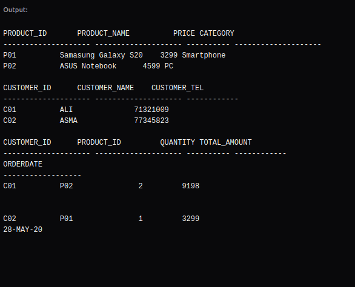

# SQL Data Manipulation language

## Overview

This checkpoint implements new data into the previously created tables.

The database contains three tables:

- **CUSTOMER** stores customer information.
- **PRODUCT** stores product information.
- **ORDERS** stores orders and their corresponding quantities and amounts.

## Newly added data

